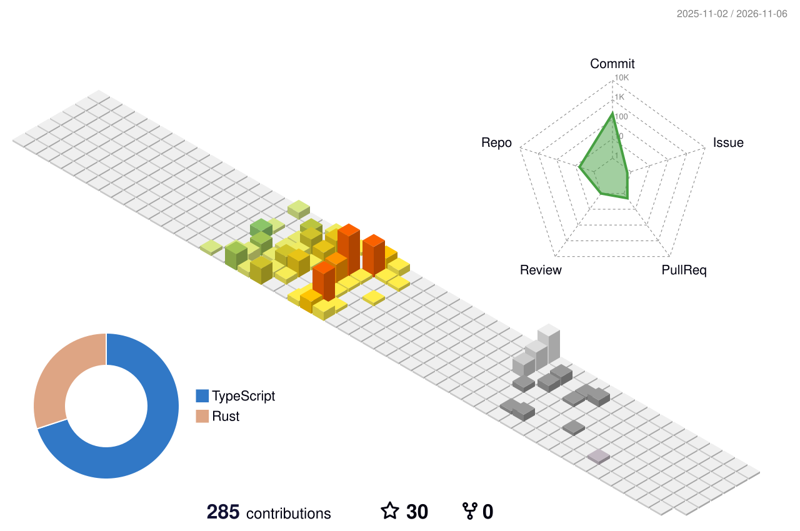

# Hi there, I'm Zhichang (Alfie) Lin 👋

**AI Application Engineer / AI Agent Engineer** — I build enterprise AI applications, agent systems, and reliable LLM workflows from zero to production.

<code></code>
<code></code>
<code></code>
<code></code>
<code></code>
<code></code>
<code></code>

<code></code>
<code></code>
<code></code>
<code></code>
<code></code>

<code></code>
<code></code>
<code></code>
<code></code>
<code></code>
<code></code>
<code></code>

- 🤖 Building **long-horizon enterprise agents** — agent runtimes, ReAct & Plan-and-Execute flows, skill routing, RAG pipelines, and model evaluation that ships to production.
- 🔎 RAG & retrieval: BM25, vector search, reranking, Elasticsearch, knowledge-base QA.
- 🧠 Evaluated and iterated across Qwen, Kimi, GLM with prompt engineering and regression testing.
- 💬 Open to any fabulous idea — if you're looking for collaboration, shoot me a DM.
- ⚡ Vinyl digger, love chill vibe flowing in da house. [No Music, No Life.](https://duranduran.fandom.com/wiki/No_Music,_No_Life.)

📝 Writing about what I build and learn at my [blog](http://loveconnect.us/) · 📫 alfiezclin@outlook.com

## 🔥 Featured work

* [X-Claw](https://github.com/Cheong43) 🔮🤖 - A production long-horizon agent system for enterprise and office workflows — skill routing, context & memory management, sandboxed execution, and an agent eval framework with a **97% core-task regression success rate**.

* [mitosis-cli](https://github.com/Cheong43/mitosis-cli) 🧬⌨️ - A memory-aware coding agent CLI built with React & Ink: branching ReAct, five governed tools, Mempedia long-term memory, reusable SKILL.md workflows, and sandboxed local execution.

* [mempedia](https://github.com/Cheong43/mempedia) 🧠🦀 - A Rust engine for traceable, forkable, mergeable, and explainable long-term agent memory across four layers — versioned knowledge DAG, episodic recall, preferences, and skills.

* [spwnr](https://github.com/Cheong43/spwnr) 🌊🛠️ - An open-source toolkit for packaging, validating, injecting, and orchestrating reusable multi-agent workers across Claude Code, Codex, Copilot, and OpenCode.

* [Jammo Chat](https://github.com/UoB-IBM-TextMessaging-Team/JammoChat) 🤖💬 - AI & AR messaging app, a collaboration with the IBM University program (Flutter + Unity + IBM Watson).

* [ReadBy](https://readby-web.vercel.app/) 🔮📄 - AI read-it-later tool that summarizes any saved article — GPT + LangChain.

* [My Little Query](https://github.com/Cheong43/MyLittleQuery) 📊 - A database server engine written in native Java: recursive descent parser, AST interpreter, and local I/O.

## 📈

